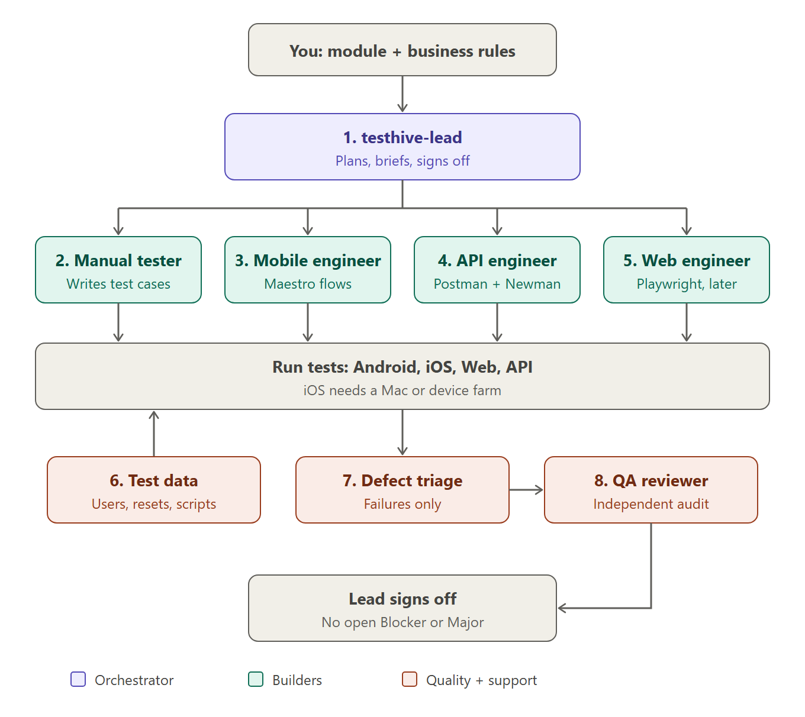

# TestHive

TestHive is a team of AI QA agents that runs inside [Claude Code](https://claude.com/claude-code). You give it a product module and its business rules; it helps you analyse the requirements, design test cases, automate them for **mobile (Maestro)**, **API (Postman/Newman)** and **web (Playwright)**, run them, and report bugs, with a human approval between every stage.

Everything lives as plain files in your project folder, so the work is visible, reviewable in git, and does not depend on any one chat or person.



> **Status (v0.8.0).** Working today: the agent team and scripts, the phase 0 foundations (stage gates, approval log, run storage, masking), phase 1, business analysis (documents, API specs, designs, or exploring a built web/Android app; requirement and gap registers; Excel questions and answers; approval and baselines) phase 2, test design (cases traced to the approved requirements, design techniques, risk-based priority, tags, AI pre-review, Excel review, change impact) and TestHive Studio, a local web page that takes a person who does not use a terminal from an empty project to approved test cases, running the agents with a button. Still being built phase by phase: tool advice, automation scaffolds, HTML reports and a UI: see [docs/ROADMAP.md](docs/ROADMAP.md). Tested on Windows 11. The selftest also runs on Linux and macOS in GitHub Actions; there is no hands-on macOS/Linux test yet.

## What you need
| Need | Why | Who provides it |
|---|---|---|
| A Claude account with Claude Code | The agents run in Claude Code | You / your team's Claude plan |
| Git (on Windows it also gives Git Bash) | To get TestHive, and to run its bash scripts; `hive.cmd` finds Git Bash for you | Install it first. Windows: `winget install --id Git.Git -e` |
| Python 3, Node.js, Java 17+, Maestro, adb, Newman | Scripts, mobile and API runs | `setup --install` installs them |
| An Android phone with USB debugging, or an emulator | Mobile tests | You |
| A Mac (or BrowserStack, later phase) | iOS tests; Windows cannot run the iOS Simulator | You |
| Optional: Tesseract OCR | Blacking out personal data in screenshots | `setup --install --ocr` |
| Administrator rights on Windows, or IT help | Several installers (Git, Node.js, Python, Java, Tesseract) install for all users and ask for admin rights. Maestro, adb, Newman and Claude Code do not. | You / IT |

## Start in 10 minutes
Commands are shown for **Windows PowerShell** (`.\hive ...`). On macOS/Linux type `bash scripts/hive.sh ...` instead of `.\hive ...`.

1. **Get your copy.** On GitHub click **Use this template** to make a **private** repo for your project (your requirements and test evidence should not be public), then clone it and open a terminal in the folder.
2. **Check the tools:** `.\hive setup --check`. Install what is missing with `.\hive setup --install` (add `--ocr` for screenshot masking, `--web` for web tests). Open a **new** terminal afterwards.
3. **Verify TestHive works on your machine:** `.\hive selftest` must end with `SELFTEST PASS`.
4. **See it in action (optional, 1 minute):** `.\hive demo/phase0/run.sh`.
5. **Create your project files:** `.\hive init-project "My Project"`.
6. **Describe your app:** fill in `CONTEXT.md` (app name, platforms, environment, quirks) and `.env` (app id, URLs; never committed). Connect the phone and check it: `.\hive check-devices`.
7. **Give it a module:** put the module's documents in `requirements/sources/<MODULE>/` (PDF, Word, Excel, text, OpenAPI, designs), or have a URL or APK of the built product ready.
8. **Start the team:** `claude --agent testhive-lead`, then tell it e.g. *"Module SIGNUP, web and API. The documents are in requirements/sources/SIGNUP/."* It shows a plan and waits for your approval at every stage (below).

Stuck? See [docs/TROUBLESHOOTING.md](docs/TROUBLESHOOTING.md).

## How work flows
Each module goes through six stages. A stage cannot start until a named person approves the one before it; every decision is logged in `workflow/APPROVALS.md`.

| Stage | TestHive does | You get | You decide |
|---|---|---|---|
| 1. Analysis | Reads the requirements, lists gaps and questions | Gap register | Answer and approve |
| 2. Design | Writes test cases, reviews them | Excel test cases | Add, edit, approve |
| 3. Tools | Compares tools for your product | Decision matrix | Choose |
| 4. Automation | Writes the test project | Scripts, tagged smoke/sanity/regression/E2E | Review |
| 5. Execution | Runs what you pick, keeps evidence | Runs with screenshots, video, API logs | What to run |
| 6. Reporting | Writes bug and test reports | HTML reports for testers and managers | Sign off |

```
.\hive stage status SIGNUP
.\hive stage approve SIGNUP analysis --by "<your name>" --comment "All High gaps answered"
```

## The team
| Agent | Model | Role |
|---|---|---|
| `testhive-lead` | Sonnet | Runs the pipeline, briefs the others, keeps the board, stops at every approval. Never writes tests. |
| `business-analyst` | Sonnet | Reads documents, API specs and designs, or explores a built web/Android app; writes the requirement and gap registers; re-checks your answers. |
| `manual-tester` | Sonnet | Designs test cases from the approved requirements (techniques, risk, tags, exact expected results); handles your review. |
| `mobile-automation-engineer` | Sonnet | Maestro flows for Android and iOS. |
| `api-backend-test-engineer` | Sonnet | Postman collections run with Newman. |
| `web-automation-engineer` | Sonnet | Playwright + TypeScript. Idle until a web flow exists. |
| `test-data-env-manager` | Haiku | Test users, resets, environment files. Scripts first. |
| `defect-triage` | Sonnet | Runs on failures only: test defect, environment or real bug; writes bug reports. |
| `qa-reviewer` | Opus | Independent audit and module sign-off; design pre-review (on Sonnet) before you see the cases. |

Call one agent directly inside Claude Code with `/th-lead`, `/th-analyst`, `/th-manual`, `/th-mobile`, `/th-api`, `/th-web`, `/th-data`, `/th-triage`, `/th-review` followed by the task, or from a terminal with `.\hive th mobile "automate TC-SIGNUP-001"`. `/th-lead` makes the current session act as the Lead (a subagent cannot start other agents); for a full module `claude --agent testhive-lead` is the better start.

Maintainer tools (not part of the QA team): the `studio-security-reviewer` and `docs-consistency-reviewer` agents, and the `/release-phase` and `/rerecord-demo` skills. See [docs/MAINTAINING.md](docs/MAINTAINING.md).

## Analyse a module (stage 1)
1. Put the module's documents in `requirements/sources/<MODULE>/` (PDF, Word, Excel, text, OpenAPI/Swagger, design images). No documents? Give the analyst a URL or an APK instead: it explores the built product and drafts the requirements as **observed** behaviour for you to confirm.
2. In Claude Code: `/th-analyst SIGNUP` (add e.g. `url=https://staging.example.com, test environment`), or ask the Lead.
3. Open `analysis/SIGNUP-analysis.xlsx`, sheet **Gaps**: answer the questions in the yellow columns (you may add your own questions in a new row). Save.
4. Ask the analyst to re-check (`/th-analyst re-check SIGNUP`). Repeat 3-4 until no High question is open.
5. Approve: `.\hive stage approve SIGNUP analysis --by "<your name>"`. The requirements are frozen as `analysis/baseline/SIGNUP/v1/`.

See it end to end with a fictional app: `.\hive demo/phase1/run.sh` (recorded agent, free) or `--live` (real agent, uses your Claude plan).

## Design the tests (stage 2)
1. After the analysis is approved: `/th-manual SIGNUP` (or ask the Lead). The manual-tester designs cases from `analysis/baseline/SIGNUP/v<latest>/`: every case names the requirements it tests, its technique (equivalence, boundary, decision table, state transition, error guessing, use case, checklist), its risk and its tags (`smoke`, `sanity`, `regression`, `e2e`). Priority comes from a fixed rule: the requirement's priority times the case's risk.
2. `.\hive check-design SIGNUP` shows the counts and anything missing: a requirement without a case, a P0 rule without a negative case, a limit without a boundary case.
3. The Lead asks the qa-reviewer for a pre-review (`reviews/DESIGN-SIGNUP-1.md`) and has the findings fixed before you see anything.
4. Open `test-cases/SIGNUP-design.xlsx`. Sheet **Cases**: set **Review** to Accepted, Change (say what in Review Comment) or Remove, or edit a case directly; add your own case in an empty row. Sheet **Requests**: ask for more cases ("add cases for pasted mobile numbers"). Sheets **Coverage** and **Assumptions** show what each requirement is tested by and which open questions the cases rely on. Save.
5. Ask the manual-tester to re-check (`/th-manual re-check SIGNUP`); it imports your review and handles every row. Repeat 4-5 as needed.
6. Approve: `.\hive stage approve SIGNUP design --by "<your name>"`. The cases are frozen as `test-cases/baseline/SIGNUP/v1/`.
7. Requirements changed later? `.\hive stage reopen SIGNUP analysis --by "<name>" --comment "<what>"`, let the analyst update them, approve again, then `.\hive design-impact SIGNUP --apply` marks the affected cases **Needs update** until they are fixed.

See it with the fictional app: `.\hive demo/phase2/run.sh` (recorded agents, free) or `--live`.

## TestHive Studio (no terminal needed)
`.\hive studio` opens a page in your browser, on this PC only. On it you can:
- **first opening:** describe the project (name, app, platforms, test environment addresses). Studio writes `PROJECT_BRIEF.md`, `CONTEXT.md` and the non-secret `.env` values; passwords and tokens are never typed into Studio;
- **New module:** give its code and title, and optionally the address of the built product (say whether it is a test environment);
- **Sources:** drop the requirement documents (PDF, Word, Excel, text, OpenAPI, design images; an APK for Android), check what masking would hide and tick the real names, then **Read the documents** (free, no AI). Open any document, or see the text TestHive read from it (what the analyst works from); **Remove** one, or bring back an earlier version or a removed document (**Earlier versions**, with who changed what). Nothing is deleted: a replaced or removed document is kept in `_old/`. If a document changes after the analysis was approved, **Next** says so and the module is no longer ready for automation until the analysis is reopened;
- **Ready for automation:** a card on every module shows the three approvals (requirements, test cases, tools) and what is still assumed;
- see every module and its six stages, with what to do next. Where an agent is needed, **Run** starts it in the background (Claude Code, on your plan, after you confirm): a panel shows its steps live, **Stop** ends it, and saving on that module pauses while it works. **Activity** lists every run with its result, time, cost and log (`runs/agents/`). The same command is still shown, to run it in Claude Code yourself if you prefer;
- **Analysis:** answer the analyst's questions, or ask your own;
- **Design:** review the test cases (Accepted, Change with a comment, Remove), see each case's steps and expected result, see coverage and the open questions the cases rely on, add a case, or ask for more cases. Once the design is approved its cases are read-only until it is reopened. A requirement ID anywhere opens the requirement with its questions and cases;
- **Approvals:** see whether a stage passes its rules, then approve, reject or reopen it, signed with your name; the decision log is there too;
- **Archive a module** added by mistake or no longer tested (bottom of Sources; you type its code and a reason): the module, its documents, questions, cases, baselines and logs move to `archive/<MODULE>-<time>/`, and **Restore** on the start page puts everything back. The same from a terminal: `.\hive stage archive <MODULE> --by "<name>" --comment "<why>"` and `.\hive stage restore <MODULE>-<time> --by "<name>"`.

Every module and tab has its own address (for example `#/SIGNUP/design`), so a refresh or a bookmark opens the same place.

Studio writes the same files with the same rules as the Excel workbooks (which still work: download and upload them from the page) and as the `stage` script. If an agent or Excel saved in the meantime, Studio refuses to overwrite and reloads. Agents started by Studio can run only the TestHive scripts and edit files: anything that would need your permission fails and is reported (allowing it from the page comes later). Approvals always stay with you. Keep its window open while you use it; Ctrl+C stops it. Try it: `.\hive demo/phase2d/run.sh` presses Run through the whole flow with recorded agents (free; `--live` for real ones); `.\hive demo/phase2c/run.sh` starts from an empty project (upload the files in `demo/phase1/sources/`); `.\hive demo/phase2b/run.sh` opens a project whose cases wait for approval.

## Scripts
Run `.\hive` with no arguments for the full list with one-line descriptions. The main ones:

| Script | What it does |
|---|---|
| `setup` | Checks and installs the tools. `--check` (default), `--install`, `--web`, `--ocr` |
| `selftest` | Proves TestHive works on this machine |
| `init-project` | Creates the project files from `templates/` |
| `stage` | Stage gates and approvals; `archive` / `restore` move a module out of the project and back (nothing is deleted) |
| `ingest` | Turns a module's documents (text, PDF, Word, Excel, OpenAPI, images) into text for the analyst; `--mask` hides personal data first |
| `explore-web` / `explore-android` | Record what a built web app (URL) or Android app (APK) actually does, as observed behaviour |
| `check-analysis` | Checks the requirement and gap registers; `--for-approval` checks they are ready to approve |
| `analysis-workbook` / `import-answers` | Excel workbook of questions for the business, and reading the answers back |
| `score-analysis` | Benchmark: how many planted gaps the analyst found |
| `check-design` | Checks a module's test cases against the approved requirements (coverage, negatives, boundaries); `--set-priority`, `--for-approval` |
| `design-workbook` / `import-review` | Excel workbook for reviewing the cases, and reading your decisions, edits, new cases and requests back |
| `design-impact` | Lists (and with `--apply` flags) the cases affected when approved requirements change |
| `score-design` | Benchmark: how many expert test conditions the cases cover |
| `studio` | Opens TestHive Studio in the browser (local only) |
| `check-private` | Fails if a private name from your git-ignored `.private-names` list is in a file that would be published |
| `run-mobile` / `run-api` / `run-web` | Run a module's tests; each run is stored in `runs/` |
| `stable` | Runs a module 3 times; only cases that pass every time count as done |
| `gate` | Definition-of-done check on the case sheet |
| `mask` | Hides personal data in documents and screenshots before Claude sees them (Arabic + English) |
| `collect-run`, `digest-failures`, `check-intake`, `check-devices`, `reset-app`, `gen-user` | Helpers used by the agents and by you |

## Privacy and safety
- `.env` holds your app ids and URLs; it is git-ignored and the agents are blocked from reading it (`.claude/settings.json`).
- Agents cannot `git push`; you publish.
- Two Claude Code hooks (`.claude/settings.json`): every file Claude edits is checked at once (shell, Python, JSON, JavaScript, PowerShell syntax; no Windows line endings where they break things), and Claude cannot edit the approval records (`workflow/APPROVALS.md`, `workflow/state.json`, the baselines): only `stage` writes them.
- Before sending business documents to Claude, mask them: `.\hive mask suggest <file>` (find names), `.\hive mask review <file>` (check every match), `.\hive mask mask <file> <out>`. The token map stays on your PC (`.mask-map.json`, git-ignored). `suggest` and `review` show real data, so only you run them.
- Use made-up test data in test environments, so screenshots never show real people.

## Rules the team follows
- Verify on the real app; never assume behaviour.
- Cases: `TC-<MODULE>-<NNN>` (an extra part is allowed, e.g. `TC-SIGNUP-API-001`), atomic steps, exact expected results, independent; priority P0 to P3.
- Real bugs are reported and the test keeps its assertion (tagged `known-bug` with the bug ID). Assertions are never weakened.
- A test is done only when it passes 3 times in a row.
- The case sheet can be edited in Excel: save it as "CSV UTF-8".

## Folder layout
```
hive.cmd             Windows launcher: .\hive <script> ...
CLAUDE.md            rules every Claude session in this folder follows
.claude/agents/      the 9 agent definitions        .claude/commands/  /th-* slash commands
.claude/settings.json  allowed and blocked commands for agents
scripts/             all scripts (lib/ holds their Python code)
templates/           files init-project copies: brief, CONTEXT, intake, board, case sheet, registers, reports, env
docs/                FORMATS, TROUBLESHOOTING, MAINTAINING, ROADMAP
demo/                one runnable demo per phase       studio/  the Studio page: index.html (markup, styles) and app.js (logic), served by scripts/lib/studio.py
mobile/ api/ web/    test code per platform
requirements/sources/  your input documents          analysis/  requirements and gap registers
workflow/            state.json, APPROVALS.md, BOARD.md, intake/     test-cases/  TestCases.csv, requests.csv, baseline/
runs/                one folder per test run           reports/ reviews/  reports and reviews
skills/testhive/     optional /testhive skill for the Claude app
```

## More documentation
- [QUICKSTART.md](QUICKSTART.md): the same start, with more detail per step.
- [docs/TROUBLESHOOTING.md](docs/TROUBLESHOOTING.md): common errors and fixes.
- [docs/FORMATS.md](docs/FORMATS.md): every file format (state, registers, runs, masking).
- [docs/MAINTAINING.md](docs/MAINTAINING.md): how TestHive is built, how to change it safely, how to release.
- [docs/ROADMAP.md](docs/ROADMAP.md): what is built and what comes next.
- [CHANGELOG.md](CHANGELOG.md): what changed in each version.

## License
MIT. See [LICENSE](LICENSE).
